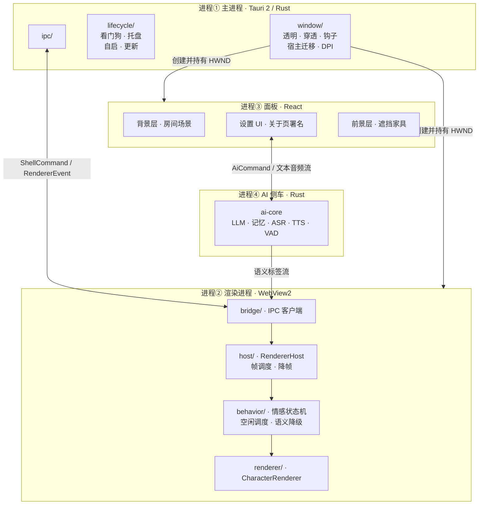
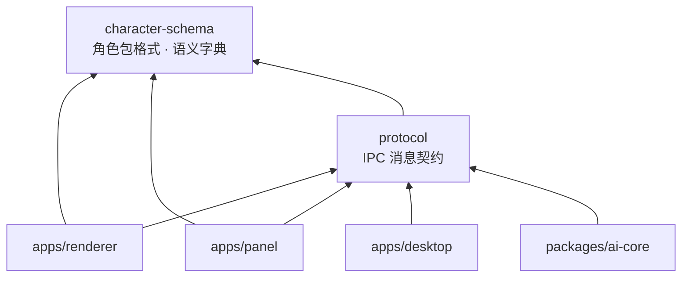
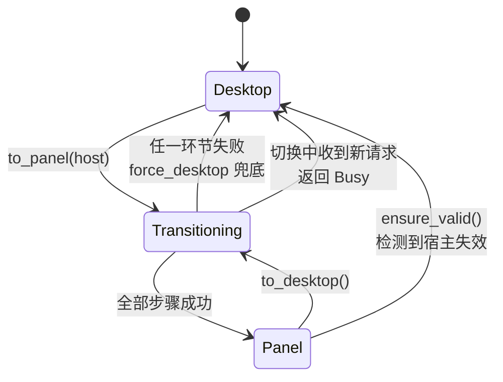
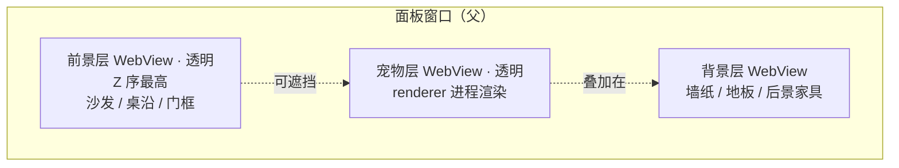
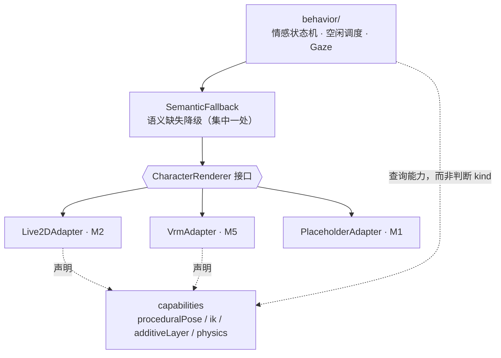
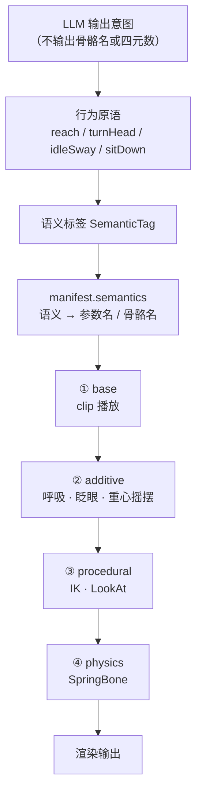

# Heart Star 架构图

> 配套：`docs/engineering-plan.md`（方案）、`docs/semantics.md`（语义字典）
> 本文件是架构的可视化索引。图用 Mermaid 写成，VS Code / GitHub 均可直接渲染。

## 图索引

| # | 图 | 回答什么问题 | review 时重点看 |
|---|---|---|---|
| 1 | 进程与窗口 | 系统由几个进程组成，谁持有谁 | 进程边界是否清晰、崩溃是否隔离 |
| 2 | 模块依赖方向 | 谁依赖谁 | 有无反向或循环依赖 |
| 3 | 形态切换状态机 | 宠物如何在桌面与面板之间搬家 | 异常分支是否都有兜底 |
| 4 | 面板三层结构 | 宠物如何被家具遮挡 | 三层 Z 序是否成立 |
| 5 | 渲染抽象与能力协商 | 2D/3D 如何共存 | 上层是否只依赖语义 |
| 6 | 动画四层管线 | AI 如何驱动到骨骼 | 层的顺序是否正确 |

---

## 1. 进程与窗口



**关键约束**

- 渲染进程崩溃 → 主进程重建，宠物不消失
- 面板崩溃 → 主进程强制把宠物回收到桌面形态
- 宠物**只有一个渲染实例**，形态切换只是换宿主，不重建

---

## 2. 模块依赖方向



**规则**

- 箭头单向，禁止反向
- `protocol` → `character-schema` 是唯一允许的契约层内部依赖（语义字典是更底层的真源）
- `character-schema` 与 `protocol` 不依赖任何 app
- 破坏这条约束，M5 接 3D 时会牵一发动全身

---

## 3. 形态切换状态机



**两个不可省略的设计**

- `Transitioning` 态拒绝并发切换，否则两次 `SetParent` 交错会让宠物位置错乱
- 任何失败都必须 `force_desktop()`，**绝不允许停留在 Transitioning**

**切换序列**（顺序固定）

```
hide → 改样式 → SetParent → SetWindowPos → show
```

先隐藏再显示，规避闪烁与重绘撕裂。

---

## 4. 面板三层结构（Z 序）



**为什么必须是三个 WebView**

Win32 子窗口永远绘制在父窗口之上，且同级子窗口按 Z 序排列。要让宠物"走到沙发后面被挡住"，单层做不到——必须是前景层 > 宠物层 > 背景层三层。

**一致性收益**：宠物层在两个形态下**始终保持透明**。桌面形态透出用户桌面，面板形态透出房间背景。渲染层只需一套合成逻辑。

---

## 5. 渲染抽象与能力协商



**两条铁律**

1. 上层只输出**语义**（`lookX` / `joy` / `lipSync`），永不出现参数名或骨骼名
2. 上层查询 `capabilities` 决定能否用 IK，**禁止写 `if (kind === 'vrm')`**

   → 3D 能力升级时上层零改动，2D 角色也能体面降级

**懒加载**：`createAdapter()` 按 `kind` 动态 `import()`，Vite 自动分包。只装 2D 角色的用户永不下载 three.js。

---

## 6. 动画四层管线



**顺序不可调换**

- ② 叠加在 ① 之上，不是替换
- ③ 覆盖 ②③ 的结果
- **④ 必须最后**：否则头转过去了头发还留在原地，看起来像穿模。这是正确性问题，不是优化问题。

**AI 不直接碰骨骼**：LLM 输出意图 → 行为原语（有限、可枚举、可约束）→ 语义标签 → manifest 映射。让 LLM 输出四元数必然摆出反关节姿势。

**程序化旋转一律相对 rest pose**：`bone.quaternion = restQuaternion * deltaQuaternion`。这一条让 T-pose / A-pose 模型的差异被自动吸收，角度约束也才有意义。

---

## 附：目录与职责速查

| 路径 | 职责 | 关键文件 |
|---|---|---|
| `packages/character-schema` | 角色包格式 · 语义字典 · 校验 CLI | `semantics.ts` `manifest.ts` `validate.ts` `cli.ts` |
| `packages/protocol` | IPC 消息契约（唯一真源） | `index.ts` |
| `packages/ai-core` | 记忆 · 检索 · ASR/TTS · LLM 编排 | `lib.rs` `memory.rs` `vad.rs` |
| `apps/desktop/src-tauri/src/window` | 透明 · 穿透 · 钩子 · 宿主迁移 · DPI | `mod.rs`（状态机）`style.rs` `host.rs` |
| `apps/desktop/src-tauri/src/lifecycle` | 看门狗 · 托盘 · 自启 | `mod.rs` |
| `apps/renderer/src/host` | canvas 生命周期 · 帧调度 · 降帧 | `RendererHost.ts` `FrameScheduler.ts` |
| `apps/renderer/src/renderer` | CharacterRenderer 接口与 adapter | `CharacterRenderer.ts` `adapters/` |
| `apps/renderer/src/behavior` | 情感状态机 · 语义降级 | `EmotionStateMachine.ts` `SemanticFallback.ts` |
| `apps/renderer/src/bridge` | IPC 客户端 | `ipc.ts` |
| `apps/panel/src` | 设置 UI · 关于页署名 | `App.tsx` |
| `assets/characters` | 角色包实例（不入库） | `<name>/manifest.json` |

---

## review 检查清单

按图顺序逐项确认：

- [ ] 图 1：进程边界是否隔离，任一进程崩溃不影响其他
- [ ] 图 2：依赖是否全部单向，无循环
- [ ] 图 3：异常分支是否都有兜底，不存在卡在中间态的可能
- [ ] 图 4：三层 Z 序是否满足"宠物可被遮挡"的需求
- [ ] 图 5：上层代码里是否出现 `kind === '...'` 判断（应为 capabilities 查询）
- [ ] 图 6：④ physics 是否在最后；程序化旋转是否相对 rest pose
